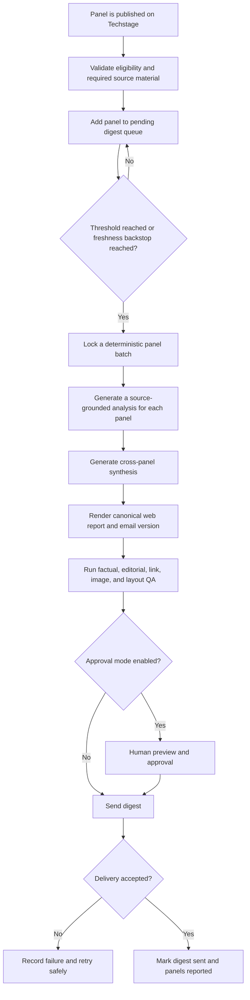

# Techstage Finimize-Inspired Report and Newsletter

## Fable Plan Mode Brief

**Status:** Planning handoff only. Do not implement from this document yet.  
**Prepared:** July 14, 2026  
**Product:** Techstage  
**Purpose:** Give Fable enough product, editorial, visual, and workflow context to create a detailed design and implementation plan for a Techstage panel-analysis digest.

---

## 1. Original inquiry and intent

The product owner asked for a read-only review of [Finimize](https://finimize.com/) as a reference for a new Techstage reporting and newsletter experience.

The core intent was:

1. Use the same typography found in Finimize reports because of its aesthetics and legibility. The desired result is the actual typeface system and measurements, not a visual approximation.
2. Create a free Techstage newsletter that follows the functional structure of Finimize's Daily Brief: concise, highly legible, jargon-light, and organized into recurring analytical sections.
3. Generate each issue from newly published Techstage panels since the previous digest.
4. Define a configurable threshold, `x`, for the number of new panels required to trigger a digest. The initial proposed value is `x = 4`.
5. When the threshold is reached, analyze the new panels, synthesize them into one cohesive report, and distribute the report to subscribers.
6. Give every panel its own headings and subheadings while also including cross-panel analysis, recurring themes, use cases, implications, contradictions, and other useful synthesis.
7. Determine when the digest should send, how the report should be designed, and how the future automated workflow should operate.

The desired experience should borrow Finimize's information-design strengths while remaining clearly and recognizably Techstage.

---

## 2. Reference findings

### 2.1 Why Finimize works as a reference

Finimize consistently converts dense subject matter into short, readable analysis. Its public newsletter promises a roughly three-minute daily read and emphasizes jargon-free explanation. Its Daily Brief format can contain multiple stories inside one issue.

Reference pages:

- [Finimize newsletter](https://finimize.com/newsletter)
- [Representative multi-story Daily Brief](https://finimize.com/content/your-daily-brief-for-july-3rd-2026)
- [Finimize brand assets](https://finimize.com/business/resources/brand-guidelines)

The recurring editorial logic observed in a representative Daily Brief is:

1. Issue title and short deck
2. Multiple story blocks
3. A title and image for each story
4. "What's going on here?"
5. "What does this mean?"
6. "Why should I care?"
7. A final audience-specific implication, such as the effect on markets

This is the functional structure to adapt for Techstage. The exact Finimize branded wording and total visual presentation should not be copied one-for-one. Techstage should own its section names, imagery, masthead, colors, and overall identity.

### 2.2 Verified live typography

The following measurements came from a read-only inspection of Finimize's live public web experience on July 14, 2026.

#### Primary fonts

- **Primary editorial font:** Inter
- **Monospace accent and metadata font:** Trispace
- **Other fonts present in the web bundle:** Poppins and Nova Mono, used as secondary or fallback assets rather than the main observed report face

Use the official upstream font distributions rather than copying Finimize-hosted font files:

- [Inter official repository](https://github.com/rsms/inter)
- [Trispace original project](https://github.com/Etcetera-Type-Co/Trispace)

Both font projects are distributed under the SIL Open Font License. Preserve the required license notices when the fonts are packaged with Techstage.

#### Observed desktop report measurements

| Element | Font | Size / line height | Weight | Notes |
|---|---|---:|---:|---|
| Report content column | — | Approximately 696 px wide | — | Central measure supporting readable line length |
| Issue title | Inter | 32 / 38.4 px | 700 | Primary report title |
| Panel/story title | Inter | 28 / 33.6 px | 700 | Repeated top-level item heading |
| Analysis copy | Inter | 20 / 30 px | 400 | Generous 1.5 line-height is central to legibility |
| Deck/summary | Inter | 16 / 22.4 px | 400 | Muted introduction |
| Newsletter metadata accent | Trispace | 14 / 19.6 px | 400 | Used selectively, not for long prose |

#### Observed colors

- Headline color: `#030303`
- Primary editorial text: `#383F4F`
- Muted metadata/deck: `#7F879C`

These are reference measurements, not a mandate to copy Finimize's complete brand. Fable should determine how the typography integrates with Techstage's existing Polaris visual system and which colors remain Techstage-owned.

### 2.3 Email rendering constraint

Exact typography can be achieved in the Techstage web report and other controlled render targets. It cannot be guaranteed across every email client because support for web fonts varies.

The plan should therefore distinguish:

- **Canonical web report:** Highest-fidelity typography and complete interactive experience
- **Email digest:** Inter where supported, with a carefully chosen web-safe fallback and a layout that remains legible when custom fonts are unavailable
- **Optional PDF/export:** Controlled typography matching the canonical report, if included in scope

---

## 3. Proposed Techstage editorial structure

Each digest should feel like one editorial product rather than four unrelated panel summaries.

### 3.1 Issue-level opening

- Techstage digest masthead
- Issue number and publication date
- "4 new Techstage panels" and estimated reading time
- One-sentence issue deck
- **The big picture:** a short synthesis of the most important cross-panel development
- Optional issue hero image or editorial composition

### 3.2 Repeated section for each panel

For each included panel:

1. Panel title
2. Event, publication date, speakers, titles, and companies
3. Panel image or approved editorial image
4. **What was discussed?**
5. **What does it mean?**
6. **Where could this be applied?**
7. **Why should technology leaders care?**
8. Key use cases
9. Notable claims or source-grounded quotations
10. Link to watch or read the complete panel

The labels above are proposed Techstage-owned equivalents of Finimize's recurring analytical questions. Fable may recommend stronger final wording, but it should preserve the same progression:

> factual summary → interpretation → application → audience relevance

### 3.3 Cross-panel synthesis

Close each issue with analysis that could not be produced by reading the panel summaries independently:

- Themes repeated across panels
- Emerging technologies or use cases
- Agreements and contradictions among speakers
- Strategic implications for founders, operators, investors, and technology leaders
- Signals that appear early but are not yet consensus
- What to watch next
- Links to every included panel

### 3.4 Voice and editorial standards

The generated writing should be:

- Concise and jargon-light
- Analytical rather than promotional
- Specific about speakers, companies, technologies, and evidence
- Clear about the difference between a speaker's claim and Techstage's synthesis
- Useful to a reader who has not watched the panels
- Cohesive across all included panels
- Free of invented quotations, unsupported numbers, or ungrounded conclusions

---

## 4. Proposed trigger and automation behavior

### 4.1 Primary trigger

Set a configurable variable:

```text
x = number of newly published, eligible, unreported panels required to create a digest
```

Initial recommendation:

```text
x = 4
```

When four eligible panels accumulate, the system should lock the four oldest unreported panel IDs into a new digest. Panels published after that snapshot belong to the next digest.

This creates predictable issue length, generation cost, and reading time.

### 4.2 Time-based backstop

A threshold-only system can leave one to three panels waiting indefinitely during a slow publishing period. Add a freshness backstop:

```text
Send when pending_panel_count >= 4
OR
when the oldest eligible pending panel is 7 days old
```

The seven-day value should be configurable. Fable should evaluate how this rule is communicated in the admin experience and whether a short digest containing fewer than four panels uses a distinct title or layout.

### 4.3 Recommended workflow



### 4.4 Reliability requirements

The future implementation plan should include:

- An idempotency key based on the locked panel IDs and template/generation version
- A job lock so two simultaneous publication events cannot create duplicate digests
- Explicit states such as `pending`, `generating`, `needs_review`, `approved`, `sending`, `sent`, and `failed`
- Marking panels as reported only after the delivery provider accepts the send
- Safe retry behavior that cannot email subscribers twice
- Source citations or traceability from every generated claim back to the panel transcript and metadata
- A reconciliation job that detects missed publication events
- A manual kill switch and manual re-run capability
- Versioned prompts and templates so regenerated reports remain auditable

### 4.5 Initial launch mode

Do not begin with unsupervised automatic sending.

Recommended rollout:

1. Generate drafts only
2. Human reviews factual accuracy, tone, images, links, and layout
3. Record edits and use them to improve prompts and validation
4. Send to an internal test list
5. Measure generation cost, delivery cost, rendering quality, and editorial review time
6. Enable subscriber delivery with approval required
7. Consider automatic sending only after quality thresholds are consistently met

---

## 5. Suggested conceptual data objects

Fable should validate these against the existing Techstage architecture rather than assuming they are final database tables.

### Digest

- Digest ID
- Issue number
- Status
- Trigger reason: `panel_threshold`, `freshness_backstop`, or `manual`
- Locked panel IDs
- Prompt version
- Template version
- Estimated reading time
- Generated issue title, deck, and synthesis
- Web publication URL
- Scheduled, approved, sent, and failure timestamps

### Digest panel

- Digest ID
- Panel ID
- Ordering position
- Source transcript/version
- Per-panel generated sections
- Extracted use cases
- Selected claims and quotations
- Image reference
- Validation status

### Generation run

- Model and configuration
- Input versions
- Token usage and cost
- Start/end timestamps
- Validation results
- Error and retry history

### Delivery

- Digest ID
- Audience/list ID
- Email provider message or campaign ID
- Idempotency key
- Delivery status
- Aggregate delivery metrics

### Subscriber preferences

- Subscription status and consent timestamps
- Frequency preference, if offered
- Topic/company/speaker interests, if personalization enters scope later
- Unsubscribe and suppression state

---

## 6. Scope boundaries for the first version

The first plan should prioritize a dependable editorial digest, not a fully personalized newsletter platform.

### In scope for planning

- Canonical web-report layout
- Responsive email layout
- Finimize-verified typography adapted to Techstage
- Four-panel editorial hierarchy
- Cross-panel synthesis
- Configurable threshold and freshness trigger
- Draft, review, approval, sending, and failure states
- Subscriber delivery and unsubscribe requirements
- Admin preview and operational controls
- Cost and quality measurement
- Accessibility and mobile readability

### Defer unless Fable identifies a critical dependency

- Per-subscriber AI-generated personalization
- Real-time newsletter generation for every individual
- Multiple language editions
- Complex advertising or sponsorship placement
- Fully automatic sending before a supervised quality period
- Copying Finimize logos, artwork, hosted fonts, branded copy, or proprietary assets

---

## 7. Decisions Fable should resolve in Plan Mode

Fable should inspect the current Techstage product and existing Polaris design system, then produce a plan that resolves or explicitly presents options for the following:

### Product and editorial

1. Final Techstage-owned names for recurring analytical sections
2. Target reading time and maximum issue length
3. Whether a freshness-triggered issue with fewer than four panels uses the same layout
4. How much cross-panel synthesis appears before versus after the individual panels
5. How quotations, citations, transcript timestamps, and source links should display
6. Whether the newsletter is completely free, requires an account, or supports both states

### Visual design

1. How Inter and Trispace integrate with Polaris without weakening Techstage's identity
2. Exact desktop, tablet, mobile, and email type scales
3. Maximum content measure and spacing rhythm
4. Image strategy for the issue hero and each panel
5. Reusable components for headlines, metadata, analysis questions, use cases, quotes, and calls to action
6. Email-client fallbacks and dark-mode behavior
7. Accessibility targets, including contrast, focus behavior, semantic heading order, and minimum type sizes

### Workflow and operations

1. Where the publication event originates
2. Whether event-driven triggers are supplemented by a scheduled reconciliation scan
3. Exact batching behavior during bursts of more than four panel publications
4. Admin approval, editing, regeneration, scheduling, cancellation, and retry flows
5. Email service provider and subscriber-source integration points
6. Required analytics and cost observability
7. Failure notifications and operational ownership

### AI generation and validation

1. Per-panel analysis prompt structure
2. Cross-panel synthesis prompt structure
3. Context-window and transcript chunking strategy
4. Grounding, citation, and hallucination controls
5. Rules for quotations and transcript timestamps
6. Model selection and fallback behavior
7. Quality rubric and the conditions that block sending
8. Expected cost per four-panel issue and expected monthly operating range

---

## 8. Required Fable Plan Mode output

Fable should **not implement the feature yet**. It should return a concrete, reviewable plan containing:

1. **Current-state assessment**
   - Relevant existing Techstage screens, components, data models, services, and constraints
2. **Proposed experience architecture**
   - Subscriber journey, web-report journey, email journey, and admin journey
3. **Information architecture**
   - Full issue outline and repeated panel-section hierarchy
4. **Visual system proposal**
   - Typography tokens, layout measurements, responsive behavior, image treatment, and email fallbacks
5. **Wireframe-level screen inventory**
   - Web report, mobile report, email, subscription entry points, archive/index, admin preview, approval, and failure states
6. **Generation architecture**
   - Inputs, per-panel analysis, cross-panel synthesis, validation, rendering, and versioning
7. **Trigger and delivery architecture**
   - Threshold logic, backstop logic, batching, locking, idempotency, scheduling, sending, and retry behavior
8. **Data-model changes**
   - Proposed entities, fields, statuses, relationships, and migrations
9. **Integration map**
   - Publishing events, transcript/media sources, model provider, email provider, analytics, and subscriber management
10. **Security, privacy, consent, and compliance considerations**
11. **Testing and evaluation plan**
   - Editorial evals, factuality checks, rendering checks, email-client QA, accessibility, failure injection, and end-to-end tests
12. **Cost model**
   - One-time backfill considerations, per-issue AI cost, email-delivery cost, storage/rendering cost, and projected monthly cost
13. **Phased implementation sequence**
   - Small, verifiable phases with dependencies, acceptance criteria, and rollback points
14. **Open questions and explicit decisions required from the product owner**

The plan should identify which work belongs to Fable, which work belongs to the backend/integration layer, and which decisions must be returned to Codex for implementation into the shared Techstage codebase.

---

## 9. Acceptance criteria for the eventual feature

The eventual implementation should not be considered ready until:

- A four-panel test batch produces one cohesive, source-grounded issue
- Every included panel has accurate speaker, company, event, image, and source-link metadata
- Cross-panel conclusions are traceable to the included transcripts
- No invented quotations or unsupported claims pass validation
- The canonical web report uses the approved Inter/Trispace typography system
- The email remains readable in clients without custom-font support
- The same panel cannot be included in two sent digests unintentionally
- Retries cannot produce duplicate subscriber emails
- Admins can preview, approve, cancel, regenerate, and safely retry an issue
- A one-to-three-panel backlog cannot remain stranded indefinitely
- Subscriber consent, unsubscribe, and suppression behavior are verified
- AI generation, email delivery, and operational costs are observable per issue
- The supervised launch period meets the agreed editorial quality threshold

---

## 10. Short prompt to give Fable with this file

> Read `FINIMIZE_NEWSLETTER_FABLE_PLAN_BRIEF.md` completely. Work in Plan Mode only and do not implement or edit files yet. Inspect the current Techstage product and Polaris design system, validate the assumptions in the brief against the existing architecture, and produce the full planning output requested in Section 8. Preserve the verified Finimize typography findings, but create a distinctly Techstage visual and editorial system. Be explicit about trigger behavior, data changes, AI grounding, review workflows, email constraints, costs, phased implementation, and any decisions that require product-owner approval. The resulting plan will be reviewed and then handed back to Codex for coordinated implementation.
