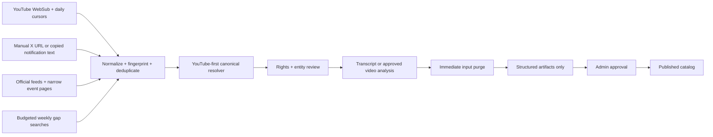

# TechStage Production Backbone Handoff

## Current status

The production backbone is implemented in **safe local mode**. No Supabase project was linked, no migration was applied, no provider/model/payment API was called, no schedule or WebSub lease was registered, no image was downloaded, no deployment occurred, and no backfill ran.

The starting repository state was preserved:

- Starting commit: `e43b5e354d0577a16cca0ef9dfd6714bba17784b`
- Starting dirty-diff SHA-256: `00752db419f19d9448c987557a58999bf1273703dcd90b10da614764122468ee`
- Public UI boundary: every public page and shared public style remains outside this implementation’s intentional change scope. Only `/admin` was replaced.

## Architecture



Runtime separation:

- Browser: public UI, admin forms, local deterministic parsing, browser-safe Supabase publishable key only.
- Supabase: Postgres, RLS, auth, storage metadata, queues, functions, budgets, audit, and entitlements.
- Provider functions: server secrets, timeouts, dry-run gates, explicit budgets, and structured response validation.
- Cloudflare Pages: the existing Vite build plus staged security headers.
- Cloudflare R2: encrypted backup destination after activation.

## Implemented files

### Browser/domain backbone

- `src/domain/operations.ts` — production stages, providers, budgets, jobs, assets, analysis artifacts, audit, and registry records.
- `src/domain/operationsValidation.ts` — Zod validation for manual intake, analysis artifacts, moments, and backfills.
- `src/backend/config.ts` — local/Supabase mode, browser-safe configuration, and fail-closed provider errors.
- `src/backend/costs.ts` — transcript/video estimates and hard budget enforcement.
- `src/backend/discovery.ts` — 100-channel reconciliation planning, YouTube-first canonical resolution, and deduplication.
- `src/backend/eventFeeds.ts` — local RSS, iCal, and JSON-LD extraction.
- `src/backend/parsers.ts` — local X/event parsing, URL normalization, fingerprints, and bounded evidence.
- `src/backend/pipeline.ts` — 18-stage job chain, guarded transitions, structured validation, ephemeral transcript lifecycle, and X timestamp removal.
- `src/backend/localOperations.ts` — offline operations snapshot, intake previews, cost estimation, audits, and zero-call refresh behavior.
- `src/backend/schedules.ts` — inactive daily, weekly, quarterly, backup, and restore definitions.
- `src/backend/providers/*` — provider-neutral contracts plus disabled and deterministic mock clients.
- `src/data/repositories/supabase.ts` — inactive browser gateway for Auth, catalog, admin, backfill, and hosted Stripe actions.

### Supabase

- `supabase/migrations/202607130001_techstage_backbone.sql` — complete schema, indexes, RLS, audit protection, queue claiming, budgets, rate limits, Stripe entitlement sync, cleanup, and inactive schedules.
- `supabase/functions/admin-api` — allowlisted admin operations and operations snapshot access.
- `supabase/functions/catalog-api` — bounded public catalog reads.
- `supabase/functions/user-api` — JWT-protected reads of only the signed-in user’s profile, notifications, and viewing progress.
- `supabase/functions/job-runner` — dry-run-first durable job claimant.
- `supabase/functions/analyze-content` — estimate/approval/budget/schema/purge path for transcript and YouTube analysis.
- `supabase/functions/asset-workflow` — Pexels-first topic search, Pixabay fallback, bounded download, approval, provenance, and Storage upload.
- `supabase/functions/youtube-websub` — challenge handling, HMAC verification, and idempotent candidate intake.
- `supabase/functions/billing` — hosted Stripe Checkout and Customer Portal creation, disabled by default.
- `supabase/functions/stripe-webhook` — signature/timestamp verification, replay protection, and transactional entitlement updates.
- `supabase/functions/_shared/provider-clients.ts` — official YouTube, Gemini, xAI, Parallel, Tavily, Pexels, and Pixabay server clients behind the global kill switch.
- `supabase/tests/rls.sql` — local database policy and retention assertions.

### Operations, hosting, and security

- `src/pages/Admin.tsx` — the new one-page operations desk; no sidebar and no public UI edits.
- `public/_headers` — staged CSP report-only policy, HSTS, referrer, MIME, permissions, and frame-source restrictions.
- `.github/workflows/ci.yml` — typecheck, offline tests, and temporary-directory build.
- `.github/workflows/security.yml` — weekly audit, Semgrep, and Gitleaks.
- `.github/dependabot.yml` — npm and Actions dependency updates.
- `scripts/backup-to-r2.sh` — confirmed, encrypted `pg_dump` upload to R2.
- `scripts/restore-drill.sh` — confirmed restore into an explicitly isolated database.
- `scripts/backfill-dry-run.mjs` — zero-network estimate from January 1, 2026.
- `.env.example`, `supabase/config.toml`, and `wrangler.toml` — inactive environment and deployment structure.

## Data and retention policy

There is deliberately no raw-transcript, X-dump, event-page-dump, or raw-provider-response table.

- X and event pastes are parsed in browser memory. Only selected titles, public URLs, short context, keywords, and fingerprints may be submitted.
- A pasted transcript is passed as an ephemeral `AnalysisInput`; after success or failure, the local reference is cleared.
- Permanent `AnalysisArtifact` records contain a summary, bounded entity/topic arrays, confidence, prompt/model version, and `raw_*_retained=false` constraints.
- Chapters, highlights, and insights are materialized separately. Evidence excerpts are limited to 280 characters.
- X-only video artifacts forcibly remove start/end timestamps.
- Audit logs are append-only and must never contain copied source content.
- Cleanup deletes expired idempotency keys, rate-limit counters, and completed operational jobs.

## Provider controls and ceilings

| Provider/workflow | Application ceiling | Activation behavior |
|---|---:|---|
| YouTube discovery | $0 cash; quota tracked | 1 upload-playlist request per registered channel; details batched by 50 |
| Manual X | $0 | Browser-only parser; raw paste cleared |
| Grok weekly X discovery | $3/month | Five 20-handle groups for a 100-handle registry; hard stop |
| Gemini pasted transcript | Per-request estimate | No approval needed within configured bound; no transcript retained |
| Gemini YouTube video | Per-request estimate | Low resolution and explicit approval |
| Grok X video | Unknown until pilot | Always approval-only; timestamps disabled |
| Parallel | 1,000 requests/month | Narrow official event URLs only |
| Tavily | 900 credits/month | 800 scheduled + 100 reserved for manual searches |
| Pexels | 20,000 requests/month | Quarterly topic search; editorial approval required |
| Pixabay | 5,000-request application ceiling | Used only if Pexels does not produce an approved option |
| Stripe | Transaction/Billing fees | Hosted surfaces; disabled until test configuration is complete |

The ingestion assumptions supplied in the implementation plan remain: roughly `$5.76–$10.08/month` at 400 panels, excluding infrastructure and unknown-cost X video pilots. Reconfirm real provider pricing immediately before activation.

## Environment checklist

Copy `.env.example` to an untracked `.env` and fill only what is being activated.

| Area | Required variables |
|---|---|
| Global safety | `PROVIDER_DRY_RUN`, `EXTERNAL_PROVIDERS_ENABLED`, `ADMIN_EMAILS`, `APP_ORIGIN`, `JOB_RUNNER_SECRET` |
| Browser Supabase | `VITE_DATA_MODE`, `VITE_SUPABASE_URL`, `VITE_SUPABASE_PUBLISHABLE_KEY` |
| Server Supabase | `SUPABASE_URL`, `SUPABASE_PUBLISHABLE_KEY`, `SUPABASE_SERVICE_ROLE_KEY`, `SUPABASE_DB_URL` |
| Google sign-in | `GOOGLE_OAUTH_CLIENT_ID`, `GOOGLE_OAUTH_CLIENT_SECRET` |
| YouTube | `YOUTUBE_API_KEY`, `YOUTUBE_WEBSUB_CALLBACK_SECRET` |
| Analysis/X | `GEMINI_API_KEY`, `XAI_API_KEY` |
| Event gaps | `PARALLEL_API_KEY`, `TAVILY_API_KEY` |
| Assets | `PEXELS_API_KEY`, optional `PIXABAY_API_KEY` |
| Stripe | publishable/secret keys, webhook secret, monthly and annual price IDs |
| Optional email | `RESEND_API_KEY`, `RESEND_FROM_EMAIL` |
| Backups | R2 account/key/bucket/endpoint and a separately stored `BACKUP_ENCRYPTION_KEY` |

Never create a `VITE_*` variable for service-role, model, payment, backup, or provider secrets.

## Local verification commands

```bash
npm ci
npm run typecheck
npm run test:offline
npm run build:safe
node scripts/backfill-dry-run.mjs 2026-01-01 2026-07-13 100 5000
```

`build:safe` writes to `/tmp/techstage-build`, so the tracked `dist` directory and Fable’s current output are not overwritten.

Optional disposable local Supabase verification, after installing Docker and the Supabase CLI:

```bash
supabase start
supabase db reset
supabase test db
```

These commands affect only the local Supabase container. Do not run `supabase link` or `supabase db push` until production activation is explicitly approved.

## Activation order

1. Create a Supabase project and configure Google OAuth/PKCE. Keep `VITE_DATA_MODE=local`.
2. Apply and test the migration in a disposable local Supabase database.
3. Create the owner profile, set `role='admin'`, and set the same email in server-only `ADMIN_EMAILS`.
4. Deploy Edge Functions while `PROVIDER_DRY_RUN=true` and `EXTERNAL_PROVIDERS_ENABLED=false`.
5. Populate and review the initial 100 YouTube channels/upload playlists, X handles, official feeds, and narrow event URLs.
6. Configure Stripe test products/prices, the test webhook, Checkout, Portal, retry tests, and entitlement readback.
7. Add one provider credential at a time; test its disabled, budget-blocked, success, timeout, and retry paths.
8. Register WebSub callbacks only after the public callback and callback secret are live.
9. Run the backfill estimator, review candidate/quota/model ceilings, then approve a small test batch.
10. Switch the frontend to `VITE_DATA_MODE=supabase` only after DTO compatibility, RLS, admin allowlist, restore, and takedown tests pass.
11. Create Cloudflare Pages/R2 resources and deploy. Promote the CSP from report-only only after reviewing violations.
12. Upgrade Supabase before meaningful paid-customer reliance or prove external backup/restore reliability under load.

## Implemented but not activated

| Capability | Code status | Missing activation item |
|---|---|---|
| Supabase database/RLS | Authored, unapplied | Project, local migration test, explicit push approval |
| Google OAuth | Configured off | Client ID/secret and redirect review |
| Durable schedules | Seeded disabled | Scheduler/cron registration and enable approval |
| YouTube/WebSub | Handler/client staged | Key, 100-channel registry, public callback, lease registration |
| X weekly discovery | Client/budget staged | xAI key and measured token estimate |
| Transcript analysis | Schema/estimate/purge staged | Gemini key and prompt evaluation |
| Video analysis | Schema/approval path staged | Gemini/xAI keys and measured pilot |
| Parallel/Tavily | Clients/budgets staged | Keys and reviewed URL/query registry |
| Pexels/Pixabay | Clients/approval records staged | Keys and editorial selection |
| Supabase Storage | Metadata staged | Buckets/policies and approved downloads |
| Stripe | Hosted flow/webhook staged | Test keys, product/price IDs, webhook, end-to-end tests |
| Resend | Disabled adapter | Key, verified sender, notification policy |
| Cloudflare Pages/R2 | Config/scripts staged | Project, bindings, credentials, deploy approval |
| Backfill | Estimator staged | Reviewed registry, ceiling, explicit execution approval |
| Production model/provider calls | Hard-disabled | Both global safety switches plus per-provider setup |

## WebSub and scheduler activation examples

These are examples for the future operator; they were **not executed**.

```bash
# WebSub: one registration per reviewed YouTube channel topic.
curl -X POST https://pubsubhubbub.appspot.com/subscribe \
  -d hub.mode=subscribe \
  -d hub.callback=https://YOUR_PROJECT.functions.supabase.co/youtube-websub \
  -d hub.topic=https://www.youtube.com/xml/feeds/videos.xml?channel_id=CHANNEL_ID \
  -d hub.verify=async \
  -d hub.secret=YOUR_CALLBACK_SECRET

# Production migration only after local verification and explicit approval.
supabase link --project-ref YOUR_PROJECT_REF
supabase db push --dry-run
supabase db push

# Backfill remains estimate-first.
node scripts/backfill-dry-run.mjs 2026-01-01 2026-07-13 100 5000
```

Scheduler registration is intentionally absent. Register jobs only after each corresponding integration is healthy; enabling a `job_schedules` row alone does not create a cron trigger.

## Backup and restore

Backup and restore scripts require explicit confirmation variables to prevent accidental execution:

```bash
BACKUP_CONFIRM=YES ./scripts/backup-to-r2.sh
RESTORE_CONFIRM=ISOLATED ENCRYPTED_BACKUP_FILE=/path/to/file.enc ./scripts/restore-drill.sh
```

- Store `BACKUP_ENCRYPTION_KEY` separately from R2 credentials.
- Restore only into a disposable isolated database.
- After each drill, record its date/status in `backup_records` and remove the drill database.
- A backup is not trusted until the restore drill validates catalog, job, and audit counts.

## Backfill and rollback

Backfill:

1. Snapshot current source cursors and row counts.
2. Run the estimator for January 1, 2026 through the activation date.
3. Start with a small candidate ceiling and dry-run deduplication.
4. Review rights/entity/analysis costs before any model request.
5. Increase batches only after duplicate rate, provider quota, and artifact quality are known.

Rollback:

- Frontend: keep `VITE_DATA_MODE=local`; no public component requires the production backend.
- Providers: set `EXTERNAL_PROVIDERS_ENABLED=false` or `PROVIDER_DRY_RUN=true` immediately.
- Schedules: disable all `job_schedules` rows and remove external cron triggers.
- Publishing: block candidates and revoke affected media sources; never delete audit history.
- Database: restore into an isolated project first, verify, then use the Supabase recovery procedure appropriate to the environment.
- Stripe: disable Checkout entry points and keep webhook receipt processing available until subscription state is reconciled.

## Security controls

- Browser secrets are structurally excluded; providers live in server functions.
- Admin requests require verified JWT, `profiles.role='admin'`, and server-only email allowlist membership.
- Premium records are protected by server-derived entitlements and RLS.
- WebSub and Stripe signatures are verified with replay/timestamp protection.
- Provider calls have a global kill switch, key validation, timeouts, bounded budgets, and durable idempotency.
- Candidate publishing requires non-blocked rights and canonical media at both database and pipeline layers.
- Audit history is append-only.
- CSP is staged report-only to avoid changing public behavior before deployment evidence is collected.
- CI has no production credentials and blocks outbound network use during tests.
- Monthly Codex Security review and pre-launch review remain manual operational requirements.

## Fable / Claude context

TechStage is a registry for technology panels and adjacent long-form media. Its differentiator is reliable discovery, canonical resolution, structured analysis, and editorial review—not a public visual redesign.

Hard boundary for future UI work:

- Do not change public page composition, shared typography, navigation, cards, or styling as part of backend activation.
- `/admin` is intentionally one continuous, dense, calm Polaris operations canvas with no sidebar.
- Keep provider cost/health/disabled reasons visible. Never make a paid or missing-key action look active.
- Never add a raw transcript/history viewer, raw X dump history, or raw provider response panel.
- Preserve the local repository path until production DTOs and RLS are accepted.
- The current keyboard unlock is demo-only and must never be treated as production authority.

## Acceptance evidence

At implementation handoff:

- `npm run typecheck` passes.
- `npm run test:offline` passes 18 tests across 7 files.
- The test bootstrap replaces `fetch` with an outbound-network rejection.
- The admin component test confirms all nine operational sections render on one page.
- The 100-channel test proves 100 upload-playlist requests and 100 quota units before detail batches.
- The pipeline test proves malformed model output fails closed and X video timestamps are removed.
- The SQL policy test asserts RLS and verifies that no transcript table exists.
